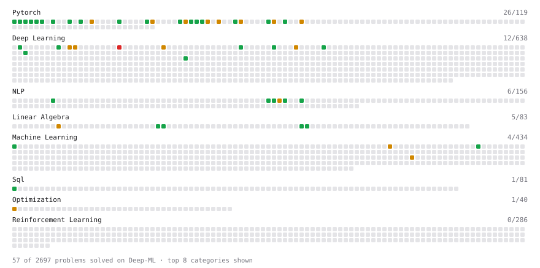

# Deep-ML

My machine learning practice from [Deep-ML](https://www.deep-ml.com). Every solution here was written by hand.

**18** solved · 18 problems · 0 labs · 0 math

[**Browse the interactive portfolio**](https://mon3stera.github.io/deep-ml/) to replay this filling in over time.

## Problems

| | Difficulty | Solved | |
| --- | --- | --- | --- |
| [Build a Linear Regression Model with nn.Module](https://www.deep-ml.com/problems/885) | easy | 2026-11-23 | [solution](problems/0885-build-a-linear-regression-model-with-nn-module) |
| [Build an MLP with nn.Sequential](https://www.deep-ml.com/problems/887) | easy | 2026-11-20 | [solution](problems/0887-build-an-mlp-with-nn-sequential) |
| [Create a Float Tensor from a Python List](https://www.deep-ml.com/problems/880) | easy | 2026-11-20 | [solution](problems/0880-create-a-float-tensor-from-a-python-list) |
| [Implement a Linear Layer Forward Pass with Matrix Multiplication](https://www.deep-ml.com/problems/883) | easy | 2026-11-20 | [solution](problems/0883-implement-a-linear-layer-forward-pass-with-matrix-multiplication) |
| [Implement Dropout from Scratch](https://www.deep-ml.com/problems/901) | easy | 2026-11-21 | [solution](problems/0901-implement-dropout-from-scratch) |
| [Implement LayerNorm from Scratch](https://www.deep-ml.com/problems/908) | easy | 2026-11-21 | [solution](problems/0908-implement-layernorm-from-scratch) |
| [Implement RMSNorm (Root Mean Square Layer Normalization)](https://www.deep-ml.com/problems/372) | easy | 2026-11-21 | [solution](problems/0372-implement-rmsnorm-root-mean-square-layer-normalization) |
| [Implement SwiGLU activation function](https://www.deep-ml.com/problems/156) | easy | 2026-11-23 | [solution](problems/0156-implement-swiglu-activation-function) |
| [One SGD Update Step](https://www.deep-ml.com/problems/1234) | easy | 2026-11-20 | [solution](problems/1234-one-sgd-update-step) |
| [Softmax Activation Function Implementation ](https://www.deep-ml.com/problems/23) | easy | 2026-11-20 | [solution](problems/0023-softmax-activation-function-implementation) |
| [Binary Cross-Entropy from Logits](https://www.deep-ml.com/problems/1229) | medium | 2026-11-20 | [solution](problems/1229-binary-cross-entropy-from-logits) |
| [Calculate AUC (Area Under ROC Curve)](https://www.deep-ml.com/problems/277) | medium | 2026-11-21 | [solution](problems/0277-calculate-auc-area-under-roc-curve) |
| [Implement Adam Optimization Algorithm](https://www.deep-ml.com/problems/49) | medium | 2026-11-20 | [solution](problems/0049-implement-adam-optimization-algorithm) |
| [Implement AdamW Optimizer Step](https://www.deep-ml.com/problems/169) | medium | 2026-11-20 | [solution](problems/0169-implement-adamw-optimizer-step) |
| [Implement Masked Self-Attention](https://www.deep-ml.com/problems/107) | medium | 2026-11-21 | [solution](problems/0107-implement-masked-self-attention) |
| [Numerically Stable Cross-Entropy](https://www.deep-ml.com/problems/914) | medium | 2026-11-20 | [solution](problems/0914-numerically-stable-cross-entropy) |
| [SGD with Momentum Step](https://www.deep-ml.com/problems/1235) | medium | 2026-11-20 | [solution](problems/1235-sgd-with-momentum-step) |
| [Implement Multi-Head Attention](https://www.deep-ml.com/problems/94) | hard | 2026-11-20 | [solution](problems/0094-implement-multi-head-attention) |

---

_This file is regenerated by Deep-ML on every push._
